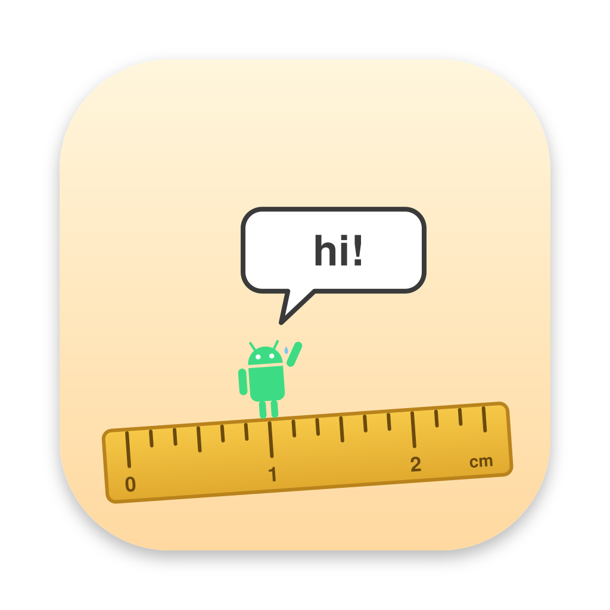

# Mini

Mini runs Android on your Mac, in a window, like any other app. You get a real Android phone or tablet on your desktop: install apps, play games, test your own software. You don't need Android Studio or Google's Android Emulator.

**Why "Mini"?** I named the folder "mini-android-emulator", and somehow that stuck.

## What you need
- A Mac with Apple Silicon (M1 or newer). Intel Macs won't work.
- macOS 15 (Sequoia) or newer.
- About 10 GB of free disk space for Android and one device. Each extra device takes more as you use it.

## Install
1. Download the latest `Mini-….dmg` from the [Releases page](https://github.com/ohaiibuzzle/mini-android-emulator-mac/releases).
2. Open it and drag **Mini** into **Applications**.
3. Open Mini. The first time, macOS will refuse, because Mini isn't notarized by Apple. Go to **System Settings → Privacy & Security**, scroll down and click **Open Anyway**. You only do this once.

## Getting started
1. **Accept Google's license.** Android itself comes from Google, and Mini isn't allowed to include it. On first launch Mini shows you Google's license, then downloads the pieces it needs.
2. **Create a device.** Open **Devices** (⌘⇧D), click **+**, pick a name, a phone or tablet screen, and how much memory and storage it gets. Mini downloads Android 17 (about 2 GB) the first time.
3. **Click Start.** The first boot takes a minute or two. After that it's quicker.

You can run several devices at once, each in its own window.

## Using it
- **Touch** is your mouse: click to tap, drag to swipe. If you'd rather have a mouse pointer inside Android, use **Device → Mouse Pointer** (⌘⇧M).
- **Typing** works with your Mac keyboard.
- **Game controllers** connected to your Mac work in Android games.
- The buttons in the window's toolbar, and in the menus, are the phone's buttons:

| Button | Shortcut |
|---|---|
| Back | ⌘⌫ |
| Home | ⌘⇧H |
| Recent apps | ⌘O |
| Power | ⌘P |
| Rotate left / right | ⌘← / ⌘→ |
| Volume down / up | ⌘↓ / ⌘↑ |
| Screenshot (saved to your Desktop) | ⌘S |

- **Turning a device off:** click **Stop** in Devices, close its window, or quit Mini. Mini shuts Android down properly first, so give it a few seconds. Don't force-quit Mini while a device is running: Android could lose data, just like a phone whose battery is pulled.
- **Installing apps:** Android's own Play Store isn't included. Install apps with `adb install app.apk` (Mini downloads adb into `~/Library/Application Support/Mini/platform-tools`).
- **An app looks wrong?** In **Devices**, select the device and set **OpenGL ES** to **Host translator**. It draws some apps more faithfully, though some newer games need the default.
- **Something broke?** **Mini → Show Log** (⌘L) opens the device's log, which is the most useful thing to attach to a bug report.

## Good to know
- No camera, GPS or saving a running device to resume later yet.
- Advanced: you can use a different build of Android 17 (a "GSI") with **Images… → Import GSI**. Images made this way contain Google's software, so don't share them with anyone.
- Some of those imported builds have no internet, because Mini needs extra (root) access to switch Android's network on and they don't allow it. Google's Android, the default, is fine.
- Everything Mini stores (Android, your devices and their data) is in `~/Library/Application Support/Mini`. Deleting a device in Mini moves it to the Trash.

## For developers
Building Mini yourself, and how it works inside (the engine, graphics and the many traps along the way), is in [docs/how-it-works.md](docs/how-it-works.md).

## License
Mini is under the [GPLv3](LICENSE). The patches in `patches/` keep their upstream trees' licenses: `patches/qemu` is GPL-2.0-or-later like QEMU, and `patches/rutabaga_gfx` is BSD like rutabaga_gfx.

The icon's robot is based on the Android robot, which Google created and shares under [CC BY 3.0](https://creativecommons.org/licenses/by/3.0/).
