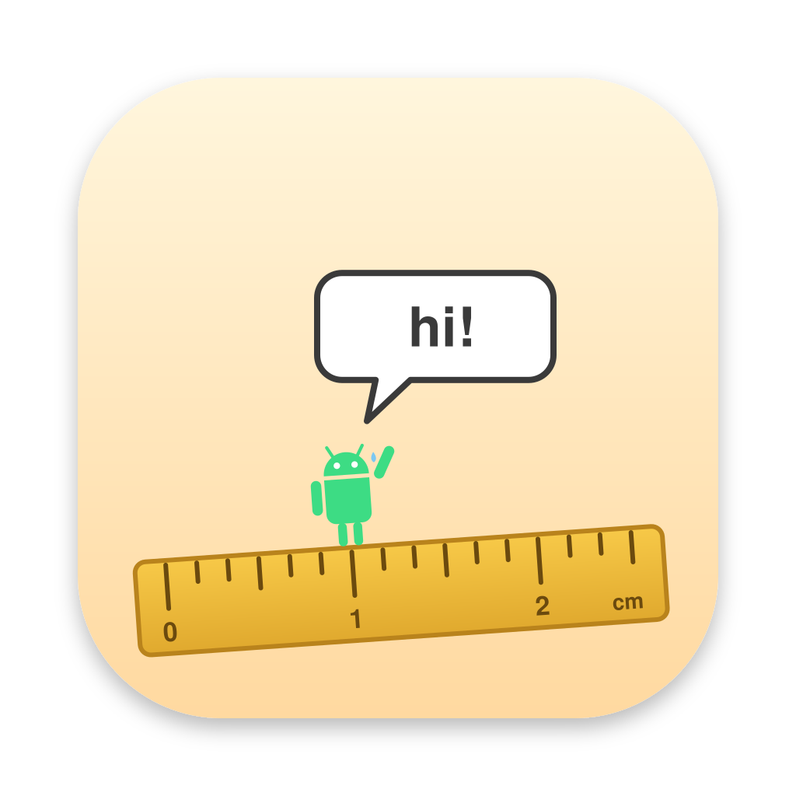

# Mini



A small Android emulator for Apple Silicon Macs. It boots Google's goldfish (ranchu) images on its own engine: upstream QEMU 11.1.2 with a few patches (`patches/`), plus gfxstream and rutabaga built from source. No Android Emulator, no Android Studio.

**Why "Mini"?** I named the folder "mini-android-emulator", and somehow that stuck.

## Build and run
```sh
scripts/bundle.sh && open build/Mini.app   # first run builds MoltenVK and QEMU (brew deps: see scripts/build-qemu.sh)
swift test --package-path frontend         # unit tests
```
Mini doesn't ship anything of Google's, because the Android SDK license forbids it. On first launch it shows that license and downloads platform-tools (adb). The API 37 system image is downloaded the same way when you create a device. Everything lives in `~/Library/Application Support/Mini`.

## How a VM is created
1. **An image.** The image is either Google's API 37 Google APIs image or an Android 17 GSI. **Import GSI** runs `scripts/gsi-image.py`, which puts the GSI's system next to Google's vendor and system_dlkm (copied out of the stock super partition) on a plain GPT disk. It also patches the ramdisk's fstab to mount them by name instead of as logical partitions. Images are kept read-only in `system-images/`, in the SDK layout.
2. **A device.** **Devices → +** writes `Devices/<name>/config.ini`, using the emulator's keys for screen, RAM and storage. Nothing else happens yet.
3. **First boot.** Mini puts each writable disk in a qcow2 overlay on a raw base: encryption key, cache and `/data`. `/data` starts as an ext4 made by `mke2fs`, seeded from the image's `data/`. It is made "pre-zeroed", or the guest spends minutes zeroing inode tables. `vendor.img` and `system.img` are attached straight from the image, read-only.
4. **Boot config.** The emulator would normally write the boot configuration. Mini writes it itself as a Linux bootconfig appended to the image's ramdisk (`initrd-mini`). That config moves graphics from goldfish_pipe to virtio-gpu, and names the serial ports for the modem and Bluetooth.
5. **QEMU** runs `-M virt -accel hvf` with `kernel-ranchu` and the virtio devices the goldfish vendor expects. Some of them have a host side in Mini:
   - **vsock** (`android-vsock`, patch 0002) carries boot properties, sensors and adbd.
   - **The modem and Bluetooth** run on virtio-serial ports. Mini answers both from Swift (`Modem.swift`, `Bluetooth.swift`).
   - **The battery** is a fixed goldfish battery (patch 0004).
6. **After boot,** Mini registers the guest with adb as `emulator-5554`, or the next free `emulator-5556`, `-5558`… when other devices or emulators are running (`--port <even port>` pins it). It wraps eth0 in `virt_wifi`, because the stock image only routes through Wi-Fi, and lifts the 60 Hz cap if you asked for more. Stopping a device, closing its window or quitting Mini runs `svc power shutdown` and waits, so `/data` is unmounted cleanly.

Devices runs any number of devices side by side. **Start Headless** (or `Mini --start <device> --headless`) boots one with no window, for scrcpy or another adb client to show; Mini then copies no frames. **Show Window** attaches one later.

## How graphics work
```
app GLES ─▶ ANGLE (in the guest) ─▶ Vulkan ─▶ gfxstream guest driver ─▶ virtio-gpu
  ─▶ QEMU virtio-gpu-rutabaga ─▶ rutabaga ─▶ gfxstream host ─▶ MoltenVK ─▶ Metal
composer scanout ─▶ QEMU console ─▶ mini-display ─▶ POSIX shm ─▶ Mini's window
```
The tricky parts:
- **GLES runs in the guest by default.** Mini sets `GuestVulkanOnly`, and the guest's own ANGLE turns GLES into Vulkan, so the bootconfig says `androidboot.hardwareegl=angle`.
- **Or on the host, per device** (Settings → OpenGL ES → Host translator), for apps ANGLE draws wrong. Then guest GLES streams to gfxstream's old GLES translator, which runs on Apple's OpenGL 4.1 (so GLES 3.0 at most). Vulkan still goes through gfxstream either way. Getting there took three things:
  - `hardwareegl=emulation`, plus `ANDROID_EMU_RENDERER=host` (otherwise gfxstream sets GL up like it does for SwiftShader: a GL 2.1 context).
  - ANGLE's shader translator. gfxstream is built with `USE_ANGLE_SHADER_PARSER` and `dlopen`s `libshadertranslator.dylib`. CI builds that library from AOSP's ANGLE (`scripts/build-shadertranslator.sh`).
  - `QEMU_NEXT`. Without it, gfxstream on macOS posts frames only on a UI thread, which QEMU doesn't have, and the guest freezes at the first compose.
- **GLES 3.1 needs a private-API MoltenVK.** ANGLE only offers GLES 3.x if the device has `VK_EXT_provoking_vertex`, which MoltenVK only exposes when built with `MVK_USE_METAL_PRIVATE_API=1` (`scripts/build-moltenvk.sh`). Without it, every app gets GLES 2.0.
- **No goldfish pipe.** Graphics go over virtio-gpu (`gltransport=virtio-gpu-asg`), and gralloc is minigbm. The image's default mapper needs `goldfish_address_space`, which upstream QEMU doesn't have.
- **The display size has to reach the composer.** Mini passes it through QEMU into rutabaga's C interface (patches `qemu/0001`, `rutabaga_gfx/0001`). Without it, the composer assumes 1280×1024 and every atomic commit fails with "Plane must cover entire CRTC".
- **Frames never touch the disk.** `mini-display` (patch 0003) copies each guest flush into a double buffer that Mini maps: rotated, into the half Mini isn't showing. It then names that half over a socket. The buffer is POSIX shm, because macOS writes a mapped file's dirty pages back to the SSD: that's gigabytes a minute at 60 fps. QEMU's own surfaces had the same problem through its memfd fallback (patch 0005).
- **shm sizes round up to 16 KB pages.** QEMU splits the buffer by the size `fstat` reports. If Mini's frame size isn't page-aligned, every second frame starts at a slightly different offset, and the picture wraps sideways.
- There's still one CPU copy per flush (the `shortcut:` in `ui/mini.c`). Zero-copy into a Metal texture is the next step if it shows up in profiles.

## Known limits
- One device at a time, since the adb port is fixed (5555).
- No camera, GPS or quick boot.
- Internet on the stock image needs `adb root`, which Google APIs images allow; Play Store and most GSI user builds don't.
- GSI-derived images contain Google's vendor, so don't redistribute them.

## License
Mini is under the [GPLv3](LICENSE). The patches in `patches/` keep their upstream trees' licenses: `patches/qemu` is GPL-2.0-or-later like QEMU, and `patches/rutabaga_gfx` is BSD like rutabaga_gfx.

The icon's robot is based on the Android robot, which Google created and shares under [CC BY 3.0](https://creativecommons.org/licenses/by/3.0/).
